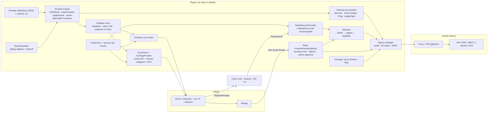

# Architettura

## Flusso dei dati

1. **Definizioni** (`Definitions/`): JSON validati con lo schema `schemas/provider.schema.json`; i segreti sono
   cifrati con AES-GCM (chiave master in `plugins/configurations/LiveHub/livehub.key`).
2. **Engine** (`Engine/`, `Formats/`): esegue le richieste dichiarate, mappa i campi (JSONPath, template, trasformazioni
   sicure) e produce `LiveEvent`, `LiveChannel`, `LiveStream`, `LiveProgram`. Tutte le richieste passano da
   `IOutboundHttp` → profilo di egress.
3. **Sync** (`Sync/`): un `BackgroundService` interroga ogni endpoint con il suo intervallo (live 45 s, oggi 5 min,
   calendario 30 min; adattivo), con backoff esponenziale e jitter. I dati buoni restano se una fonte cade.
4. **Catalogo** (`Catalog/`): unisce i provider, deduplica (stessi partecipanti, inizio ±15 min), calcola lo stato
   effettivo e rimuove gli eventi finiti. Ogni cambio produce una *revisione* che invalida la cache del Channel e
   fa riaggiornare la guida.
5. **Presentazione**: `LiveHubChannel` (cartelle per utente) e `LiveHubTunerHost`/`LiveHubListingsProvider` (Live TV).
   Gli id degli elementi sono versionati perché Jellyfin aggiorna i metadati solo sugli elementi nuovi.
6. **Riproduzione**: il client chiede le sorgenti (`LiveHubMediaSourceProvider`, utente dal contesto HTTP); alla
   scelta Jellyfin apre un `RelayLiveStream` condiviso; ffmpeg legge dal **relay** locale. Il relay risolve lo stream,
   riscrive le playlist (solo URL registrati), serve i segmenti dalla cache condivisa e passa alla fonte successiva
   se necessario.

## Componenti e responsabilità

| Cartella | Contenuto |
|---|---|
| `Definitions/`, `Engine/`, `Formats/` | modello delle definizioni, JSONPath, trasformazioni, parser |
| `Http/` | HTTP in uscita, SSRF, egress, kill switch, diagnostica VPN/gluetun, monitor di salute |
| `Wizard/` | rilevamento formato, OpenAPI, mappatura automatica, anteprima |
| `Catalog/`, `Sync/` | catalogo unico, deduplica, polling |
| `Channels/`, `LiveTv/` | Channel nativo, tuner, slot, EPG, integrazione guida |
| `Resolve/`, `Relay/`, `Playback/` | resolver, relay HLS/TS/DASH, media source, prova riproduzione |
| `Users/` | preferenze, accesso, notifiche |
| `Images/` | immagini (proxy firmato, compositi Skia) |
| `Api/`, `Web/`, `Localization/` | controller REST, pagine di configurazione, stringhe it/en |

## Sicurezza (riassunto)

- Solo `http`/`https`; SSRF bloccato su indirizzi privati/locali a ogni salto di redirect e al momento della
  connessione (anti DNS rebinding); eccezione esplicita per definizione.
- Relay: token HMAC-SHA256 con scadenza, URL registrati per sessione, limite di richieste e di stream per utente.
- Segreti cifrati a riposo, mascherati nell'interfaccia, rimossi dai log e dall'export.
- Regex con timeout, XML senza DTD/entità, limiti di dimensione sulle risposte.
- Kill switch: nessun ripiego sulla connessione diretta.
